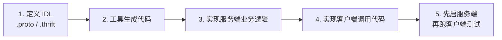

# RPC 教程 · gRPC & Kitex 实战

> 从零理解 RPC:**不只是跑通 demo,而是搞清楚每一行代码在干什么。** 包含 gRPC 与 Kitex 两个主流 Go RPC 框架的逐行讲解、可运行示例,以及从单体到微服务的演进思路。

---

## 📚 目录

- [项目简介](#项目简介)
- [教程文档](#教程文档)
- [项目结构](#项目结构)
- [快速开始](#快速开始)
- [gRPC 教程](#grpc-教程)
- [Kitex 教程](#kitex-教程)
- [RPC 核心概念](#rpc-核心概念)
- [常见问题](#常见问题)
- [许可证](#许可证)

---

## 项目简介

本仓库是一套完整的 RPC 学习材料 —— **概念、代码生成、实现、排错**四步闭环:

- ✅ **gRPC 实战** — Google 开源的跨语言 RPC 框架
- ✅ **Kitex 实战** — 字节跳动开源的高性能 Go RPC 框架
- ✅ **核心概念讲解** — RPC vs HTTP、IDL、序列化、微服务演进
- ✅ **完整代码示例** — 加减乘除计算器服务(乘除法额外返回余数)
- ✅ **逐行讲解文档** — 从 IDL 语法声明到客户端调用的每一行都拆开讲
- ✅ **排错 Q&A** — 把实际踩过的坑写进教程

三篇文档合计 **约 2,100 行**,按「概念 → 框架」顺序阅读效果最好。

---

## 教程文档

| 文档 | 篇幅 | 说明 |
|------|------|------|
| [RPC.md](./RPC.md) | 581 行 | **概念篇**:为什么需要 RPC、核心流程、序列化、RPC vs HTTP 性能对比、从单体到微服务的四阶段演进 |
| [gRPC/gRPC教程详解.md](./gRPC/gRPC教程详解.md) | 644 行 | **gRPC 篇**:IDL 逐行详解 → 代码生成 → 服务端实现 → 客户端实现 → 如何运行 |
| [Kitex/Kitex教程详解.md](./Kitex/Kitex教程详解.md) | 904 行 | **Kitex 篇**:同样的四步结构,Kitex 工具链与 Thrift 语法 |

### 为什么值得读

- **逐行拆解而非堆砌**:`calc.proto` 的每个字段单独一节讲,细到 `3.1 语法版本声明` / `3.2 包名声明` / `3.3 go_package`
- **生成的文件也讲**:`calc.pb.go` 里哪个是数据结构、哪个是服务端客户端代码,都逐个说明
- **讲坑**:重新生成会覆盖 `handler.go`、`unable to determine Go import path`、`kitex 不是内部命令` —— 都是实际会遇到的问题

---

## 项目结构

```
rpc/
├── README.md                          # 本文件
├── RPC.md                             # RPC 核心概念教程
├── .gitignore
│
├── gRPC/                              # gRPC 教程
│   ├── gRPC教程详解.md
│   └── demo/                          # 加减乘除计算器
│       ├── proto/
│       │   ├── calc.proto            # 接口定义(IDL)
│       │   ├── calc.pb.go            # 生成:数据结构
│       │   └── calc_grpc.pb.go       # 生成:服务端/客户端代码
│       ├── server/server.go
│       ├── client/client.go
│       ├── go.mod
│       └── go.sum
│
└── Kitex/                             # Kitex 教程
    ├── Kitex教程详解.md
    └── demo/
        ├── proto/calc.thrift         # 接口定义(IDL)
        ├── handler.go                 # 业务逻辑实现(手写)
        ├── main.go                    # 服务启动
        ├── client/client.go
        ├── script/bootstrap.sh
        ├── kitex_info.yaml
        ├── build.sh
        ├── go.mod
        └── go.sum
        # 注意:kitex_gen/ 被 .gitignore 忽略,需自行生成,见下文
```

---

## 快速开始

### 前置条件

| 依赖 | 版本 | 用途 |
|------|------|------|
| Go | 1.19+ | |
| `protoc` | 3.x | gRPC 代码生成 |
| `protoc-gen-go` / `protoc-gen-go-grpc` | — | gRPC 插件 |
| `kitex` | latest | Kitex 代码生成 |

```bash
# 安装 protoc 插件
go install google.golang.org/protobuf/cmd/protoc-gen-go@latest
go install google.golang.org/grpc/cmd/protoc-gen-go-grpc@latest

# 安装 kitex
go install github.com/cloudwego/kitex/tool/cmd/kitex@latest
```

### gRPC 快速开始

生成代码已提交到仓库(`calc.pb.go` / `calc_grpc.pb.go`),可直接运行:

```bash
cd gRPC/demo

# 终端 1:启动服务端
go run ./server

# 终端 2:运行客户端
go run ./client
```

如需修改 IDL 后重新生成:

```bash
cd gRPC/demo/proto
protoc --go_out=. --go-grpc_out=. calc.proto
```

### Kitex 快速开始

> ⚠️ **重要**:`kitex_gen/` 被 `.gitignore` 忽略,**未提交到仓库**。克隆后必须先重新生成,否则编译失败。

```bash
cd Kitex/demo

# 先重新生成代码(会覆盖 handler.go,请先备份!)
kitex -module demo -service calc proto/calc.thrift

# 终端 1:启动服务端
go run .

# 终端 2:运行客户端
go run ./client
```

---

## gRPC 教程

### 功能特性

- ✅ 跨语言支持(Java / Python / Go / ...)
- ✅ 基于 HTTP/2,高性能
- ✅ Protobuf 序列化,体积小、速度快
- ✅ 类型安全,编译时检查
- ✅ 支持双向流、客户端流、服务端流

### 代码生成

```bash
cd gRPC/demo/proto
protoc --go_out=. --go-grpc_out=. calc.proto
```

| 生成文件 | 内容 |
|----------|------|
| `calc.pb.go` | 消息体的数据结构 |
| `calc_grpc.pb.go` | 服务端接口与客户端桩代码 |

---

## Kitex 教程

### 功能特性

- ✅ 高性能(字节跳动内部大规模使用)
- ✅ Go 语言专属,API 简洁
- ✅ 支持 Thrift 和 Protobuf 两种 IDL
- ✅ 内置服务治理能力
- ✅ 代码生成便捷

### 代码生成

```bash
cd Kitex/demo
kitex -module demo -service calc proto/calc.thrift
```

| 生成文件 | 内容 |
|----------|------|
| `kitex_gen/` | 自动生成的代码(IDL 结构体 + 客户端桩) |
| `handler.go` | **业务逻辑模板 —— 会被覆盖,改前务必备份** |
| `main.go` | 服务启动文件 |

---

## RPC 核心概念

### 什么是 RPC?

**RPC(Remote Procedure Call)= 远程过程调用**

简单来说:**像调用本地函数一样,调用远程服务器上的函数**。

### RPC vs HTTP

| 特性 | RPC(gRPC / Kitex) | HTTP + JSON |
|------|-------------------|-------------|
| 性能 | ⭐⭐⭐⭐⭐ 极高 | ⭐⭐ 一般 |
| 序列化 | Protobuf / Thrift(二进制) | JSON(文本) |
| 类型安全 | ✅ 编译时检查 | ❌ 运行时检查 |
| 浏览器支持 | ❌ 不直接支持 | ✅ 完美支持 |
| 适用场景 | 内部微服务调用 | 对外 API、前端 |

> 想看更详细的对比(含性能差距量化、企业真实用法),见 [RPC.md](./RPC.md)。

### 核心流程



### 从单体到微服务

单体应用拆成微服务后,服务间如何通信?这正是 RPC 要解决的问题。`RPC.md` 里梳理了四个演进阶段,以及在什么规模下值得引入服务治理(服务发现、熔断降级、负载均衡、链路追踪)。

---

## 常见问题

### gRPC

**Q: `protoc-gen-go: unable to determine Go import path`**

**A:** 确保 `.proto` 文件中有 `option go_package = "./;calc";`

**Q: `package demo/proto is not in std`**

**A:** 确保在 `demo` 目录下运行,不要在 `server` 或 `client` 目录下

### Kitex

**Q: `kitex : The term 'kitex' is not recognized`**

**A:** 先安装 kitex:
```bash
go install github.com/cloudwego/kitex/tool/cmd/kitex@latest
```
确认 `$GOPATH/bin`(通常是 `~/go/bin`)已加入 `PATH`。

**Q: 重新生成后 `handler.go` 被覆盖了**

**A:** 重新生成前务必备份 `handler.go`。`kitex` 命令会重新生成业务逻辑模板,手写代码会被覆盖。

**Q: `kitex_gen` 不存在 / 编译报错找不到包**

**A:** 该目录被 `.gitignore` 忽略,克隆后需先执行一次代码生成命令(见 [Kitex 快速开始](#kitex-快速开始))。

---

## 许可证

本项目采用 [MIT License](./LICENSE)。
